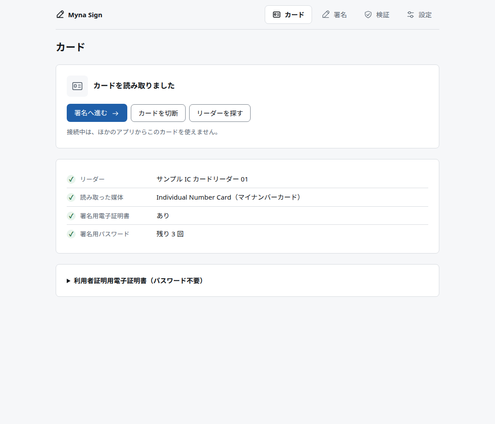
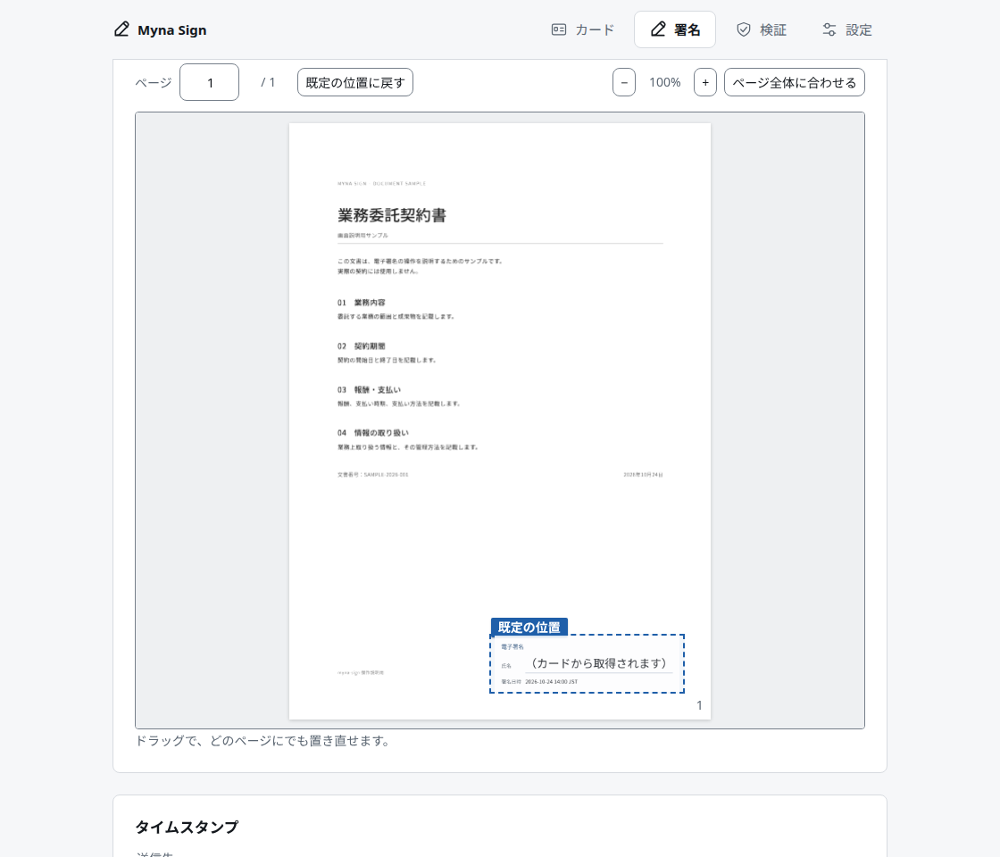
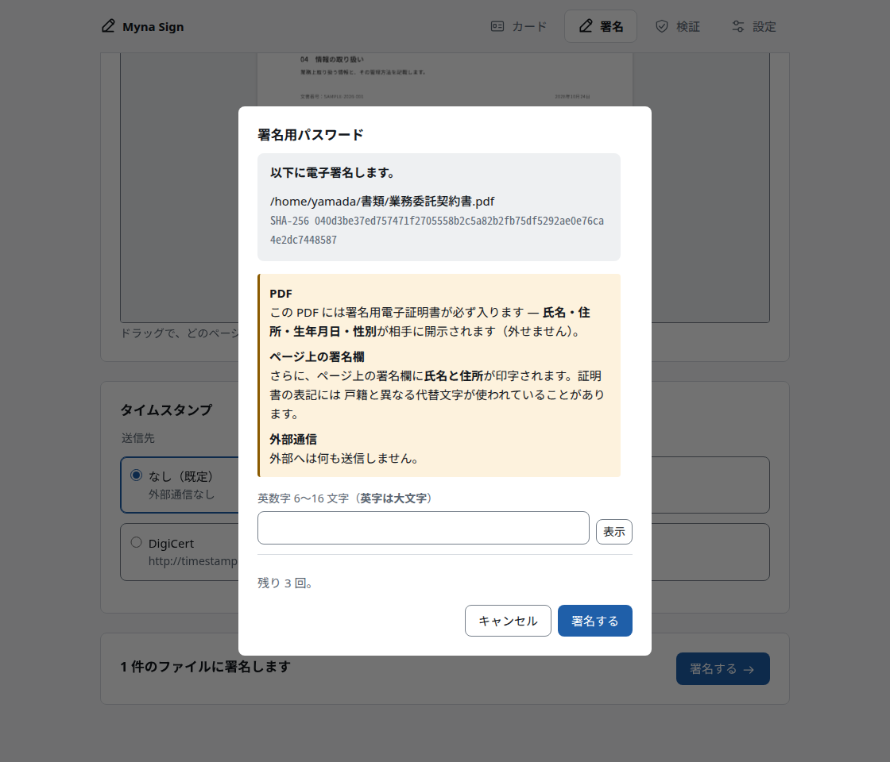
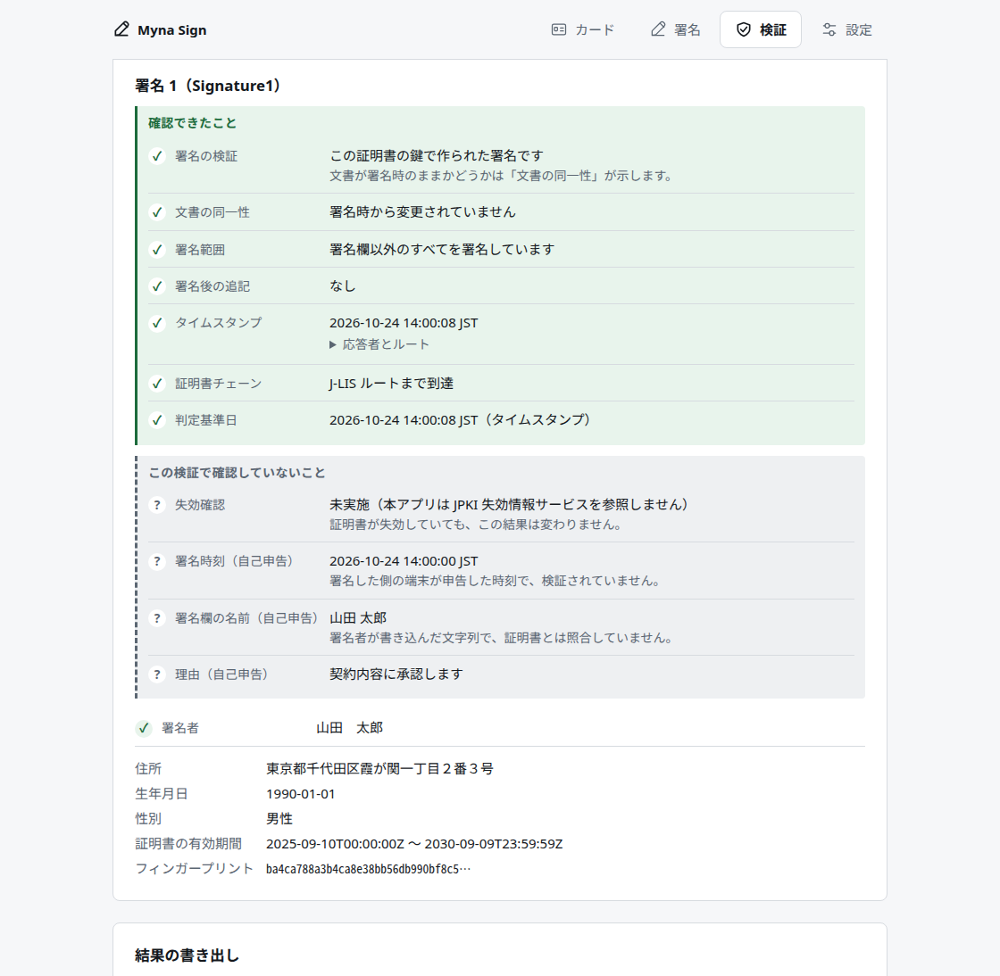
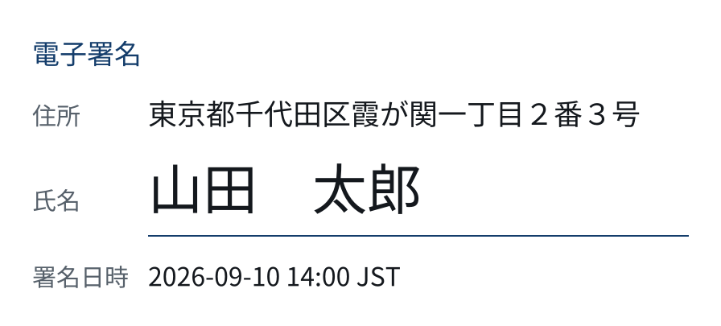

# myna-sign

マイナンバーカードの **署名用電子証明書** で、ファイルや PDF に電子署名を付け、検証するデスクトップアプリです。

- 任意のファイル: OpenPGP 分離署名 (`.asc`)。テキストならクリアテキスト署名にもできます
- PDF: 追記署名 (`adbe.pkcs7.detached`)。署名欄は自動で描画し、任意の画像も使えます
- RFC 3161 タイムスタンプ: なし / FreeTSA / DigiCert / 任意のサーバ

## 画面

サンプルのカード・文書・検証結果を使った表示例です。

### カード

接続時に読み出すのは利用者証明用電子証明書だけです。基本4情報を含む署名用電子証明書は、署名時にパスワードを入力するまで読み出しません。

署名用パスワードの残り回数は常に表示します。5 回間違えるとロックされ、市区町村の窓口でしか解除できないためです。ロックについての説明は、残りが 2 回以下か、回数が分からないときだけ表示します。



### 署名 (PDF)

署名欄はドラッグで配置します。破線の枠は、何もしなければ署名される既定の位置です。枠の中身は、実際に PDF へ描くものと同じ処理で生成します。パスワード入力前は、氏名の代わりに「（カードから取得されます）」と表示します。



### 署名する前に

パスワードを送る前に、**何に署名するのか** (ファイル名と SHA-256) と、**署名によって何が渡るのか** (基本4情報の開示、外部への送信先) を表示します。残り回数も表示し、残り 1 回のときは確認を挟みます。



### 検証

「有効」の一言で済ませず、**確認できたこと** と **確認していないこと** を分けて表示します。本アプリは失効情報を参照しないため、「失効確認: 未実施」は常に表示されます。



### 自動生成される署名欄

画像を指定しない場合に描画されます。住所と氏名は証明書から取り出します (`/Location` ではありません)。署名日時は署名した端末の時刻で、タイムスタンプで検証したものではありません。

囲み枠を描かないのは、ビューアが表示する「検証済み」の枠と紛らわしいためです。これは署名時に描く絵であり、何も検証していません。



## 構成

```
src/                     署名・検証ライブラリ
src/card.rs              PC/SC、CardSigner、セッション管理
src/bin/cli.rs           myna-sign CLI
tests/                   相互運用・CLI・実カードのテスト
src-tauri/               Tauri アプリ
ui/                      Preact + Vite
assets/                  組み込み証明書とフォント
```

ルートの `myna-sign` パッケージがライブラリと CLI を持ち、`src-tauri` は同じ Cargo workspace のメンバーです。依存解決、`Cargo.lock`、`target/` はルートで管理します。

署名形式のコードとカードの接点は `DigestSigner` trait だけです。「32 バイトの SHA-256 を渡すと 256 バイトの署名が返る」という以上のことは知りません。そのため OpenPGP・CMS・PDF・RFC 3161 はカードなしでテストできます。

## 必要なもの

| | |
|---|---|
| Rust | 1.90 以降 |
| Node.js | 20 以降 |
| PC/SC | Linux: `pcscd` + `libpcsclite1` (ビルド時は `libpcsclite-dev`) / macOS・Windows: OS 標準 |
| WebView | Linux: `libwebkit2gtk-4.1-dev`, `libgtk-3-dev`, `libsoup-3.0-dev` / macOS: OS 標準 / Windows: WebView2 |

対応環境は Linux (x86_64)、macOS (Apple Silicon)、Windows (x64) です。

## ビルド

```sh
# ライブラリと CLI (テストにカードやリーダーは不要)
cargo test

# GUI
npm ci --prefix ui
npm --prefix ui run build
cargo build --release -p myna-sign-app --features custom-protocol
```

`--features custom-protocol` は必須です。付けないとフロントエンドがバイナリに埋め込まれず、アプリは開発サーバ (localhost:5173) に接続しようとして「Connection refused」になります。`cargo tauri build` なら自動で付きます。

開発中は、Tauri CLI で Vite とアプリをまとめて起動します。

```sh
npm exec --prefix ui -- tauri dev
```

## カードなしで試す

`--soft-key` を付けると、その場で生成した使い捨ての RSA 鍵で署名します。処理の流れを確認するためのもので、作られた署名は誰の身元も証明しません。

```sh
cargo build --bin myna-sign

# 任意のファイル → .asc と公開鍵
./target/debug/myna-sign --soft-key sign contract.txt --public-key
./target/debug/myna-sign verify contract.txt.asc contract.txt

# 本文と署名を 1 ファイルにまとめる (テキストのみ。原本を渡す必要がない)
./target/debug/myna-sign --soft-key sign contract.txt --cleartext
./target/debug/myna-sign verify contract.txt.asc

# PDF にタイムスタンプ付きで署名 (署名欄は自動で描画)
./target/debug/myna-sign --soft-key --tsa digicert sign-pdf contract.pdf --reason 承認

# 自分の印影を使う / ページに何も表示しない
./target/debug/myna-sign --soft-key sign-pdf contract.pdf --image stamp.png
./target/debug/myna-sign --soft-key sign-pdf contract.pdf --invisible
./target/debug/myna-sign verify-pdf contract.pdf.signed.pdf

# 外部ツールで検証する
gpg --verify contract.txt.asc contract.txt
pdfsig contract.pdf.signed.pdf
```

## カードを使う

```sh
./target/debug/myna-sign readers
./target/debug/myna-sign card
./target/debug/myna-sign --tsa freetsa sign-pdf contract.pdf
```

**署名用パスワードを 5 回間違えるとロックされ、市区町村の窓口でしか解除できません。** CLI と GUI はどちらも、パスワードを送る前に残り回数を表示し、残り 1 回のときは確認を挟みます。

## 注意事項

**署名用電子証明書には基本4情報 (氏名・住所・生年月日・性別) が含まれます。** `.asc` や PDF に証明書を埋め込むと、受け取った相手にこれらが開示されます。`.asc` では埋め込まないこともできますが、PDF では外せません (外すと誰も検証できなくなります)。自動生成の署名欄には、氏名と住所も印字されます。

**カードのセキュリティ状態はアプリの終了後も残ります。** パスワード認証 (VERIFY) の成功状態は、再接続しても同じ AP を選択している限り消えません。消えるのは、カードがリーダーから離れたときか、別の AP を選択したときです。本アプリは切断時と終了時に MF (GlobalPlatform Issuer Security Domain) を選択して JPKI AP から離れ、電源を切らずにセキュリティ状態をリセットします。この挙動は [`myna-card` のドキュメント](https://docs.rs/myna-card) に基づいています。

**失効確認は行いません。** JPKI の失効情報は別のオンラインサービスで提供されており、本アプリはそれを参照しません。そのため検証結果に「有効」とは表示せず、「署名の検証」「証明書チェーン」「失効確認: 未実施」を別々の行で表示します。このサービスのエンドポイントは `ocspsign*.jpki.go.jp` 系と思われますが、J-LIS との契約がなければ利用できません。

## テスト

自作の署名器を自作の検証器で確かめても意味がないため、外部ツールで検証できることを合格条件にしています。

```sh
# 単体テスト + gpg / pdfsig との相互検証
cargo test

# 実際の TSA に接続するテスト (既定では実行しない)
cargo test --test interop -- --ignored
```

| 対象 | 検証に使うもの |
|---|---|
| OpenPGP 署名 | `gpg --verify` |
| PDF 署名 | `pdfsig` (poppler-utils) |
| クリアテキスト署名 | `gpg --verify` |
| RFC 3161 | `openssl ts -verify` + 実在する TSA 2 社 |

## ライセンス

MIT

同梱の Noto Sans JP (`assets/fonts/`) は SIL Open Font License 1.1 で提供されており、ライセンス全文を同じディレクトリに置いています。再配布する場合は、ライセンス全文を必ず含めてください。
